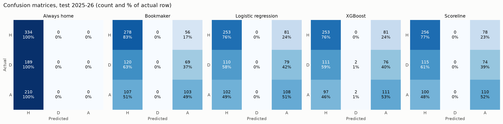
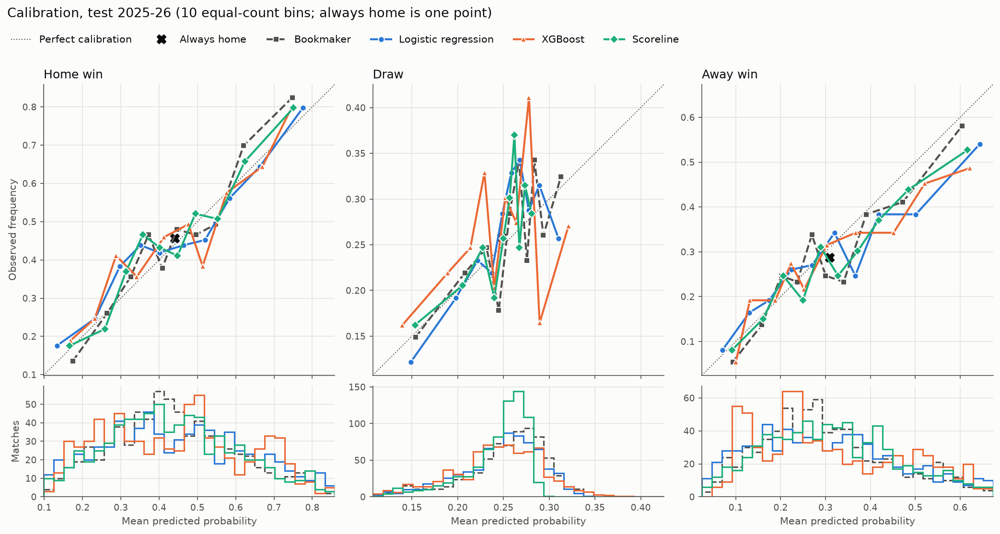

# MatchMind

Predicts home win / draw / away win (H/D/A) and full-time scorelines for Premier League
and La Liga matches, using match data from [Football-Data.co.uk](https://www.football-data.co.uk/).

COSC 470 team project: Rochak Ghimire, Sandeep Shah.

## Setup

Requires Python 3.11 (on macOS: `brew install python@3.11`).

```bash
python3.11 -m venv .venv
source .venv/bin/activate
pip install -r requirements.txt
```

Run every script from the repo root with `.venv` active.

## Run order

| Step | Command | What it does | Writes |
|---|---|---|---|
| 1 | `python src/download.py` | Downloads EPL and La Liga CSVs, 2019-20 to 2026-27 (needs internet) | `data/processed/matches.csv` |
| 2 | `python src/features.py` | 5-match rolling form and pre-match Elo, with brute-force leakage checks | `data/processed/features.csv` |
| 3 | `python src/train.py` | Baselines, logistic regression, XGBoost; prints validation and test tables | `models/` |
| 4 | `python src/predict.py` | Refits on 2019-20..2025-26 and predicts upcoming fixtures | `reports/predictions_2026-27.csv` |
| 5 | `python src/scoreline.py` | Scoreline model: tunes and scores on validation only | `reports/scoreline_val_metrics.csv`, `reports/scoreline_tuning.csv` |
| 5b | `python src/scoreline.py --test` | Refits on train+val and scores the 2025-26 test season once | `reports/scoreline_test_metrics.csv`, `reports/scoreline_test_predictions.csv`, `models/scoreline.joblib` |
| 6 | `python src/evaluate.py` | Calibration curves, confusion matrices and per-league table on validation | `reports/eval_val_*` (CSV + PNG) |
| 6b | `python src/evaluate.py --test` | The same for the 2025-26 test season | `reports/eval_test_*` (CSV + PNG) |

`scoreline.py` needs step 3 first: it reads `models/xgb_params.json` and the saved logistic
regression and XGBoost models for its comparison tables.

`evaluate.py` needs steps 3 and 5 first: it reads `models/xgb_params.json` and
`reports/scoreline_tuning.csv`, and stops if its overall metrics do not match
`reports/scoreline_*_metrics.csv`.

`data/` and `models/` are generated by the scripts and are not in the repo. `reports/` is committed.

## Data split

The split is by season, never random, and is fixed:

| Role | Seasons | Use |
|---|---|---|
| Train | 2019-20 .. 2023-24 | Fit models |
| Validate | 2024-25 | Tune settings and choose between models |
| Test | 2025-26 | Refit on train + validate, then score **once** |
| Forward check | 2026-27 | In-progress season; never used for fitting or tuning |

## ML rules

- **No leakage.** Every feature for a match uses only matches played before that match's
  date. `features.py` checks this by recomputing form and Elo for random matches with all
  later results hidden.
- **Time-based split only**, as above.
- **Always compare to baselines.** Accuracy, log loss and Brier score are reported next to
  *always home win* and the *bookmaker* (implied probabilities from market-average odds,
  with the margin removed).
- **Reproducible.** Random seeds are fixed.

## Models

- **Always home win**: always picks a home win; its probabilities are the training-season
  outcome frequencies.
- **Bookmaker**: market-average odds, normalised to probabilities. This is the benchmark to beat.
- **Logistic regression**: scaled features, multinomial.
- **XGBoost**: small grid search, with the number of trees chosen by early stopping on validation.
- **Scoreline**: one Poisson regression each for home and away goals, plus an optional
  Dixon-Coles correction for low scores (0-0, 1-0, 0-1, 1-1). The model gives a 0-6 x 0-6
  scoreline grid in which the last row and column hold "6 or more", so probabilities sum to 1.
  H/D/A probabilities are read off the grid. Settings chosen on validation: L2 strength
  0.1, a La Liga indicator on, Dixon-Coles on.

Features (all pre-match): each team's mean goals for and against, points, and shots on target
for and against over its last 5 matches, the home-minus-away differences of these, and both
teams' Elo ratings and their difference.

## Results

Log loss and Brier: lower is better. The best row in each column is in bold.

### Home / draw / away

| Model | Val acc | Val log loss | Val Brier | Test acc | Test log loss | Test Brier |
|---|---|---|---|---|---|---|
| Always home | 0.4256 | 1.0756 | 0.6515 | 0.4557 | 1.0671 | 0.6446 |
| Bookmaker | **0.5443** | **0.9639** | **0.5725** | **0.5198** | **0.9922** | **0.5923** |
| Logistic regression | 0.5362 | 0.9874 | 0.5882 | 0.4925 | 1.0102 | 0.6033 |
| XGBoost | 0.5334 | 0.9830 | 0.5852 | 0.4993 | 1.0129 | 0.6057 |
| Scoreline (H/D/A from grid) | **0.5443** | 0.9760 | 0.5811 | 0.4993 | 1.0052 | 0.6006 |

Validation is 2024-25 (fitted on 2019-20..2023-24, 733 matches). Test is 2025-26 (fitted on
2019-20..2024-25, 733 matches).

### Scorelines

| Model | Val exact hit | Val score MAE | Val xG MAE | Val score log loss | Test exact hit | Test score MAE | Test xG MAE | Test score log loss |
|---|---|---|---|---|---|---|---|---|
| Always 1-1 | **0.1323** | **0.8813** | – | – | 0.1378 | **0.8513** | – | – |
| Most common training score (1-1) | **0.1323** | **0.8813** | – | – | 0.1378 | **0.8513** | – | – |
| Training score frequencies | **0.1323** | **0.8813** | – | 2.9956 | 0.1378 | **0.8513** | – | 2.9209 |
| Scoreline model | 0.1255 | 0.8847 | 0.8780 | **2.8670** | **0.1460** | 0.8595 | 0.8516 | **2.8343** |

- **Exact hit**: share of matches where the most likely score was the real score.
- **Score MAE**: mean absolute goal error per side, using the predicted score.
- **xG MAE**: the same, using the model's expected goals.
- **Score log loss**: −log P(actual score), averaged over matches. Unlike the other three, it scores the whole probability grid.
- The most common score in the training seasons is 1-1, so that baseline matches "always 1-1".

### What the results show

- **The bookmaker is best or tied-best on every H/D/A metric in both seasons, and clearly
  best on log loss and Brier.** The scoreline model ties it on validation accuracy (0.5443);
  none of our models beats the market.
- **The scoreline model leads our models in both seasons.** Logistic regression and XGBoost
  swap second place. By log loss:
  - Test: scoreline 1.0052, logistic regression 1.0102, XGBoost 1.0129.
  - Validation: scoreline 0.9760, XGBoost 0.9830, logistic regression 0.9874.
- **The gaps are small.** The scoreline model beats the better of logistic regression and XGBoost by
  0.005-0.007 log loss, and trails the bookmaker by about 0.012-0.013. With about 730 matches
  per season, gaps this small could change in another season.
- **Exact-score hit rate is noisy.** The model lost to always 1-1 on validation (0.1255 vs
  0.1323) but beat it on test (0.1460 vs 0.1378). Always 1-1 has the lower score MAE in both
  seasons.
- **Score log loss is the reliable scoreline metric.** It uses the full probability grid,
  and the model beats the empirical score-frequency baseline in both seasons (2.8670 vs 2.9956 on validation, 2.8343 vs 2.9209 on test).

## Evaluation

All numbers below come from `reports/eval_*`. Models are refitted with the settings already
chosen (no re-tuning): on the training seasons for validation, on train + validate for test.

### Per league (test 2025-26, log loss)

| Model | EPL | La Liga |
|---|---|---|
| Always home | 1.0828 | 1.0514 |
| Bookmaker | **1.0200** | **0.9644** |
| Logistic regression | 1.0343 | 0.9860 |
| XGBoost | 1.0471 | 0.9788 |
| Scoreline | 1.0320 | 0.9785 |

- EPL was harder than La Liga on test for every model (bookmaker log loss 1.0200 vs 0.9644;
  home win rate 42% vs 49%). The same direction held on validation, but with about 366
  matches per league, a single season's gap isn't clearly beyond noise.
- Scoreline is best of our models in both leagues in both seasons, by small margins: 0.002
  ahead of logistic regression on EPL test, and essentially tied with XGBoost on La Liga test
  (0.9785 vs 0.9788).

### Draws

Almost no model ever picks a draw as its most likely outcome. Draws predicted out of 733 matches:

| Season | Actual draws | Bookmaker | Logistic regression | XGBoost | Scoreline |
|---|---|---|---|---|---|
| Validation 2024-25 | 181 | 3 | 7 | 13 | 0 |
| Test 2025-26 | 189 | 0 | 0 | 4 | 0 |

A draw is rarely the single most likely result, so the quarter of matches that end level are
almost always called wrong, and accuracy stays around 49–54%.



### Calibration

Home-win and away-win probabilities track the diagonal well for every model. Draw calibration
is noisy: draw probabilities sit in a narrow range, and each bin holds about 73 matches.
Scoreline had the highest draw calibration error on validation (0.062) and the lowest of the
four match-specific models on test (0.030).

Always home has the lowest calibration error, because it predicts the base rate for every
match. That doesn't make it a good model: it can't tell one match from another. Read
calibration together with log loss.



## Project layout

```
src/download.py    download and combine the league CSVs
src/features.py    rolling form, Elo, leakage checks
src/train.py       baselines, logistic regression, XGBoost; shared metrics
src/predict.py     full refit and upcoming-fixture predictions
src/scoreline.py   Poisson / Dixon-Coles scoreline model
src/evaluate.py    calibration, confusion matrices, per-league table
reports/           committed result tables and predictions
```
